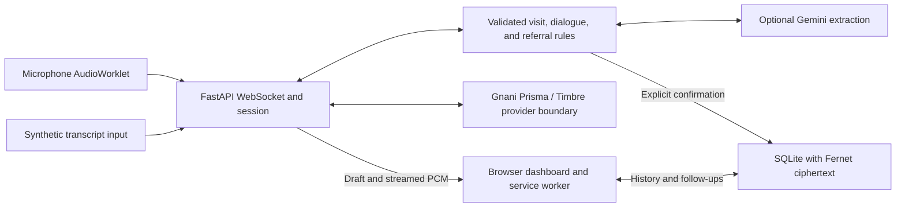

# Architecture

Each server session holds one draft. A random session token resumes that draft on the same server process for up to 30 minutes after disconnect. Each draft has a separate unique record ID. SQLite enforces uniqueness when a confirmed save is retried. The session token and structured draft are kept in browser session storage for recovery within the same tab. Raw transcripts and audio stay out of browser persistence. The service worker caches static files only. Requests for records, status, or AI continue to require a connection.

The server validates WebSocket message types and payload sizes. It uses a bounded queue for finalized transcripts and cancels streaming playback on interrupt, replacement or disconnect. Monotonic processing time is reported from final transcript to completed dialogue processing. First playable audio is estimated in the browser using the last microphone chunk over a fixed energy threshold and the scheduled first sample. This is approximate and needs live calibration.

## WebSocket contract

- Client sends `hello` with `language` set to `en` or `hi` and optional `session`. Server replies with `ready`, the session token, mode and resume flag.
- Client sends `audio` with base64 signed little-endian mono PCM16 at 16 kHz, one 512-sample (32 ms) frame per message. Client sends `interrupt` to cancel reply audio or `finish_utterance` to end the current speech segment with paced PCM silence. This control does not confirm or save the visit.
- Server sends `audio` with the same PCM encoding, `is_first_chunk` and `generation`. The browser discards stale audio by generation.
- Server sends `update` with `state`, `form`, `danger_flag` and `latency_ms`. The server leaves that field null until timing is available, and first playable audio is measured separately in the browser.
- Extensions include `transcript` with `text` and `final`, `phase` with transient processing state, `assistant` with reply text, generation and `processing_ms`, `audio_end`, `interrupted`, `heartbeat`, and `error` with `message` and `fatal`.
- Only demo mode accepts `demo_transcript` with typed synthetic input. Real mode requires the verified provider implementation. The protocol boundary itself does not make provider connections.

### Review after stopping capture

`pause_capture` stops browser recording and asks the active Prisma stream to finish its current utterance. The browser waits briefly for the final result and tells the worker if speech may still be pending. The draft and last transcript stay visible. The worker can resume capture or select **Confirm & Save**. Review reconnects can request `review_only` on the same session token without opening a new Prisma stream. `confirm_visit` carries the displayed draft revision so a stale confirmation cannot save a changed draft. Repeated confirmation reuses the existing visit ID.

Conservative English and Indian-English terminology normalization stores patient-reported concerns separately from the recognized transcript. An affirmative answer to a clinician-diagnosis question marks a patient-reported previous diagnosis. A report never establishes an independently verified diagnosis. Newborn referral screening continues to use the existing temperature thresholds and checks whether reported symptoms are about the infant.
